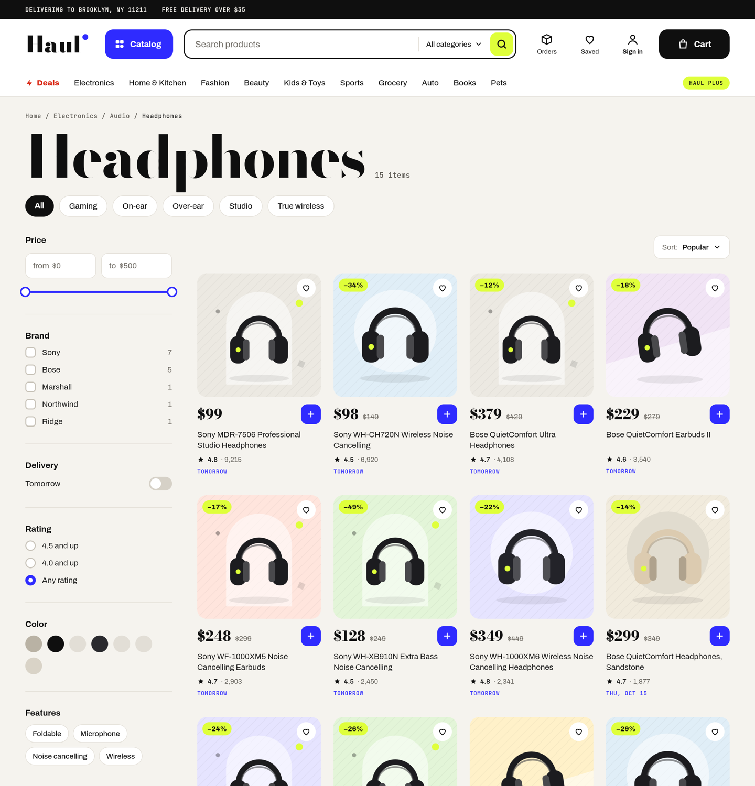
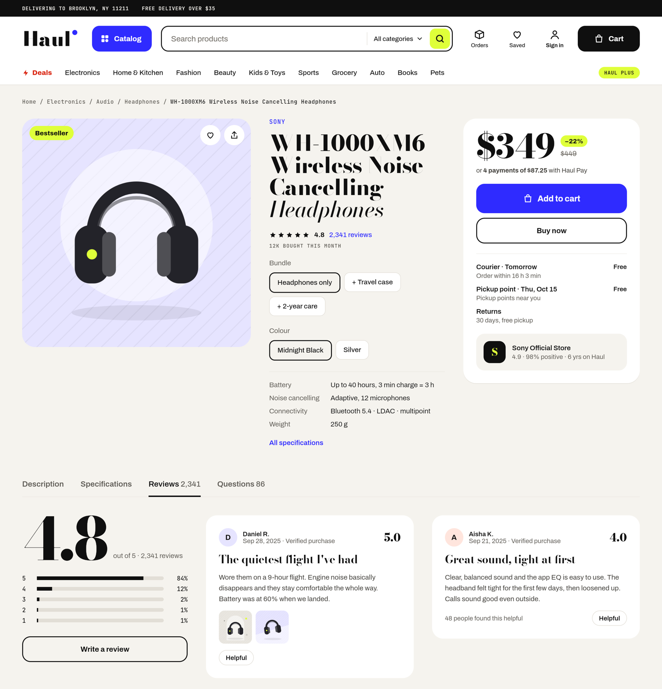
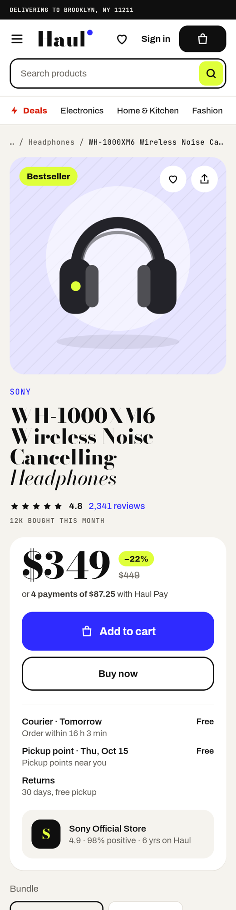

# Haul

**An open, end-to-end marketplace storefront in Kotlin** — catalog, search, cart, sign-in, checkout,
an order split across sellers, delivery, returns and refunds — built on one stack, from the database to the
pixels, and running in public at **[haul.kotlin.website](https://haul.kotlin.website)**.


## What to look at in five minutes

1. **Open [the stand](https://haul.kotlin.website).** The line above the page says it is a demo; «About this demo»
   ([/about](https://haul.kotlin.website/about)) says what is real and what is not.
2. **Read a page as the server sends it.** Every screen is a tree of components the server builds and the browser
   draws — `curl https://haul.kotlin.website/ui/home` is the home page you just saw. Built in
   [`HomeScreen.kt`](server/src/main/kotlin/io/github/youndie/haul/feature/catalog/screen/HomeScreen.kt), drawn by the
   renderers in [`HaulRenderers.kt`](composeApp/src/commonMain/kotlin/io/github/youndie/haul/registry/HaulRenderers.kt).
3. **Change a filter or the sort on a category, or press «+» on a card**, with the browser's network tab open: only
   the parts that changed arrive (`/ui/parts/c/electronics?sort=price-asc` answers an `update` naming the nodes it
   replaces), and the address follows without a reload — [`Parts.kt`](server/src/main/kotlin/io/github/youndie/haul/shell/Parts.kt).
4. **Place an order and follow it** — an order is a [petich](https://github.com/youndie/petich) saga that reserves,
   authorises and undoes in reverse ([`OrderSaga.kt`](server/src/main/kotlin/io/github/youndie/haul/feature/order/saga/OrderSaga.kt));
   checkout needs a sign-in on the stand for now.

Haul exists to put a whole Kotlin stack through a real product rather than a demo app: every screen is a tree
the server sends, the browser draws it with Compose Multiplatform on WebAssembly, and an order is a saga that
can be undone step by step. The sellers, couriers and the card processor are simulated inside the server, so the
stand integrates with nothing and charges nobody — and synthetic shoppers walk it every ten minutes, so there are
always orders moving through the saga.

## What it does

| | |
|---|---|
|  |  |

- **Browse and search** 1,920 products in 32 categories: facets, a price range, sorting, a search with
  suggestions, recent searches and scopes. Filters update the page in place — no reload, the address follows.
- **Cart and sign-in**: a guest's cart, promo codes, a changed price or a sold-out line said in words; signing
  in (OpenID Connect, in a popup or on the page) merges the guest's cart into the customer's.
- **Checkout**: courier or pickup, delivery windows, points, a card or four payments, and a placement that is
  idempotent — a double press is one order.
- **After the order**: shipments per seller moving through packed, in transit and delivered; returns, refunds,
  reorders; reviews with photos and questions; a membership with free delivery and a trial.
- **Phones too** — the same trees, drawn for the width:

<p align="center">
  
  &nbsp;&nbsp;
  
</p>

## The stack

| Layer | What | |
|---|---|---|
| Server | Ktor on the JVM, PostgreSQL through Exposed and Flyway, an AOT cache trained at image build | [zavarnik](https://github.com/youndie/zavarnik) |
| Screens | every screen is a server-driven tree; filters, steppers and tabs answer with partial updates | [kompot](https://github.com/youndie/kompot) |
| Client | Compose Multiplatform for the web (Kotlin/Wasm); the same code renders the screenshot tests on the JVM | [viddik](https://github.com/youndie/viddik) |
| Order | a saga: reserve stock, a delivery slot and points, authorise the card, open the order — and undo them in reverse | [petich](https://github.com/youndie/petich) |
| Sign-in | an OpenID Connect provider of its own, deployed beside the store | [shildik](https://github.com/youndie/shildik) |
| Watching | logs and traces, route metrics, crash reports — each order's saga is one list in the log | [tracy](https://github.com/youndie/tracy), [metrik](https://github.com/youndie/metrik), [katcher](https://github.com/youndie/katcher) |

| Module | |
|---|---|
| `shared` | the contract: the store's components on the wire, error codes, money and time (JVM, Wasm) |
| `server` | every screen as a tree, every command, the saga, the simulators |
| `composeApp` | the storefront (Wasm); its JVM target only draws the screenshots |
| `e2e` | the whole path over HTTP against the image; its `main` is the synthetic shoppers |

## Run it

The image is public. With Docker, a database and the server — seeded with the sample catalogue:

```bash
docker network create haul
docker run -d --name haul-db --network haul -e POSTGRES_DB=haul -e POSTGRES_USER=haul -e POSTGRES_PASSWORD=haul postgres:18-alpine
docker run -d --name haul --network haul -p 8080:8080 -e HAUL_DB_URL=jdbc:postgresql://haul-db:5432/haul -e HAUL_DB_USER=haul -e HAUL_DB_PASSWORD=haul -e HAUL_SEED=true ghcr.io/youndie/haul-server:v0.7.2
```

Then open <http://localhost:8080> (ready in about ten seconds). Sign-in stays off until the server is given a
provider (`HAUL_OIDC_ISSUER`, `HAUL_OIDC_CLIENT_ID`); browsing, search and a guest's cart work without one. The
Helm chart in [`charts/haul`](charts/haul) is what the public stand runs, provider and synthetic shoppers included.

To build from source, `./gradlew :server:installDist :composeApp:wasmJsBrowserDistribution` (Gradle fetches the
JDK 25 toolchain itself). The server's tests need Docker: PostgreSQL runs in Testcontainers.

## Numbers, honestly

- **First load**: the store's first frame — drawn in its own faces — at about **0.6 s** on loopback, **5.2 s** on
  DevTools' Fast 4G and **26 s** on Slow 4G. The app is 1.27 MB of brotli-compressed WebAssembly, and the home page
  moves about 4.4 MB in all; a static frame stands in while it loads. Measured with
  [`scripts/measure-first-load.py`](scripts/measure-first-load.py); the method and every run are in the research.
- **Checks on every pull request**: about 540 server tests against a real PostgreSQL, about 490 client tests,
  168 screenshot goldens, the image with its AOT cache, the chart, and the whole buy-receive-return path over HTTP.
- **Releases are walked**: a catalogue of 134 QA cases ([`docs/qa`](docs/qa/README.md)), and each run's result is
  in [`docs/qa/runs`](docs/qa/runs).

## What it is not

A storefront, not a marketplace business: nobody sells, ships or pays — the sellers, couriers and the card
processor are simulations, and the cards are test cards. The catalogue is generated; its pictures are drawn by
the server. Screen readers get names for every control, but Compose for the web (1.12) does not yet tell them a
box is ticked — the name says it instead.

## More

- [`docs/research/research-architecture.md`](docs/research/research-architecture.md) — why it is built this way,
  what was decided and measured.
- [`backlog.md`](backlog.md) — every item, open and done, and the decisions.
- [`docs/qa/`](docs/qa/README.md) — the test-case catalogue and the runs.

MIT licensed.
